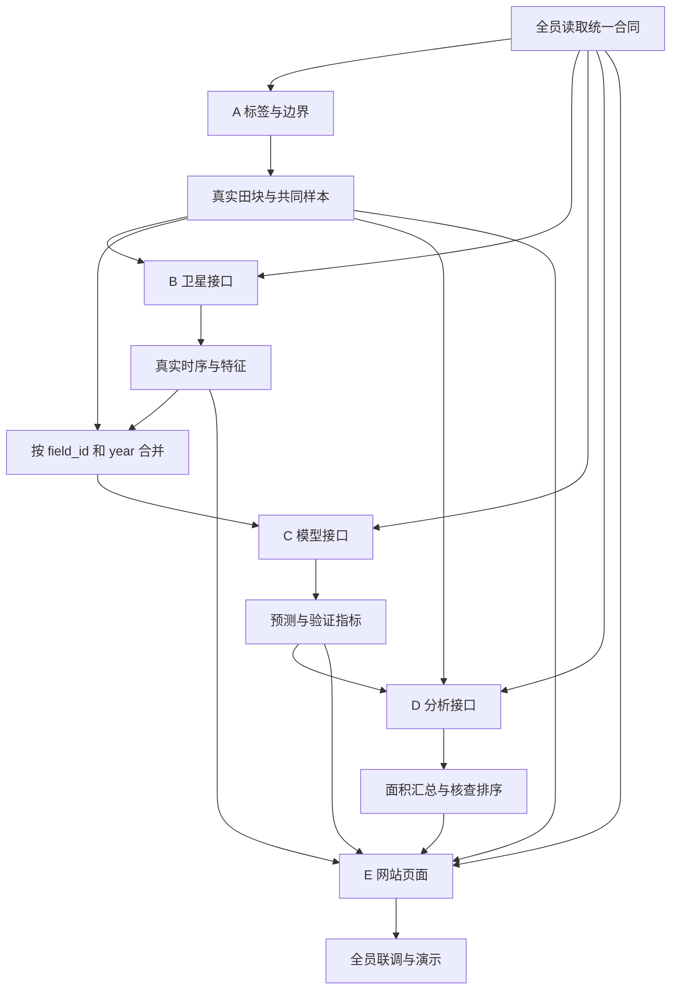

# CornHub 五人开工流程与 AI 提示词

接手前读 [项目进度](project-status.md)、[已有成果适配与分工交接](agent-handoff.md)、[主控会话工作日志](worklog-2026-11-14.md)。这些文档记录现状和待解决差异，不代表已有原型已满足本合同。

第一阶段目标：让一块真实田、一年的数据完成「官方标签 → 卫星时序 → 特征 → 模型接口 → 分析接口 → 地图」。未训练时显示未计算，不编造结果。

## 1. 五个人怎么分

|成员|职责|第一轮交付|
|---|---|---|
|A|数据负责人、集成人；适合熟悉 Python/Git 的人|真实边界、标签、共同样本、验证划分、合并检查|
|B|遥感与特征；最需要优先支持的数据任务|一块田的真实时序、特征、质量指标|
|C|模型与验证|读取、训练、验证接口；数据到齐后输出真实预测|
|D|统计、经济情景、核查排序|汇总接口、经济参数来源、核查接口|
|E|网站与最终集成|地图、时序图、详情、缺测状态、数据同步入口|

## 2. 从空电脑开始

1. 每人使用自己的 AI 编程工具，打开同一团队仓库：https://github.com/superboycyc-dot/CornHub 。没有本地克隆就让 AI 帮忙克隆；账号登录由本人完成，不共享个人凭据。没有运行环境可考虑 Codespaces，先确认团队额度。
2. 每人先拉取默认分支上的本文件 `docs/team-contract.md`。分支分别使用 `work/a-data`、`work/b-satellite`、`work/c-model`、`work/d-analysis`、`work/e-web`。若分支已存在先检查再沿用。
3. A/B/C/D/E 同时开工。A 最先交出共同样本；B 在此之前写卫星入口；C 写模型入口；D 写汇总函数、找经济参数；E 写无数据页面。
4. 文件交付走 PR，不直接推 main、不强推、不覆盖队友成果。A 维护共享格式和根目录配置，E 负责最终页面联调。A 完成核心数据后优先协助 B 检查影像与缺测。
5. 不共用可写 Notebook，每人只改自己的目录。每个交付附运行命令、依赖、数据来源、实际检查结果和阻塞项。

通用开场词，接上后面对应角色的提示词一起发给 AI：

```text
团队仓库：https://github.com/superboycyc-dot/CornHub
我是成员 A/B/C/D/E（改成自己的角色）。
请检查当前电脑是否已打开这个仓库；没有则帮助我克隆并配置所需环境。
先读仓库规则和 docs/team-contract.md，再按我的职责实际完成第一阶段。
能执行的部分直接执行；缺官方文件时明确告诉我下载哪个文件、放在哪里。
不要只给计划，不要覆盖队友成果，不要把凭据提交到 GitHub。
```

## 3. 流程图



整个项目的八步：①标签与边界 → ②卫星时序 → ③特征与质量 → ④分类验证 → ⑤概率可靠性 → ⑥面积与经济情景 → ⑦核查排序 → ⑧网站与提交。以上为依赖顺序，不要求五个人依次等待。

## 4. 官方文件从哪里来

从已登录的团队 JupyterLab 获取原件：https://hacktheharvest.farmgpu.net/anaheim04-8892/lab 。AI 无登录访问能力时由成员手动下载；不猜 token、不扫描本机凭据。

- A：`04_Evaluation/BARC_Corn.2021-2023.gpkg`、`04_Evaluation/barc_fields_explorer.ipynb`、`01_Challenge/challenge_statement.md`。
- B：`03_Geospatial_References/starter_notebook.ipynb`。
- 参考：`README.md`、协作指南和提交说明。

README 所述数据是 BARC 83 块田、2021–2023 年、44 个有标签田块年（32 grain、12 silage，34 个不同田块）。A 必须核实实际文件；发现差异就报告，不能修改数据凑数量。空白标签不是负样本。先核实主办方对训练/评估用途及划分的规定，再决定如何使用标签。

## 5. 统一格式

- 范围先限定 BARC，年份 2021、2022、2023；不先下载整州影像。全队工作区 10 GB，原始大影像不进 Git。
- CSV：UTF-8、英文 snake_case 列名、逗号分隔、必有表头；空值留空。JSON：空值 null，不使用 NaN/Infinity。
- field_id 始终为字符串，只由 A 生成：`barc_<官方稳定ID字符串>`，保留有意义的前导零和原 ID 映射。无稳定 ID 时 A 一次性生成并保存不可变映射；其他人不能用行号另造 ID。
- year 为整数；标签只用 `silage` / `grain`；label_raw 保留官方原值。
- 日期 YYYY-MM-DD；时间戳 UTC ISO 8601，末尾 Z。
- GeoJSON EPSG:4326，坐标经度在前、纬度在后；面积在确认源 CRS 后投影到 EPSG:26918 计算，单位公顷 area_ha，禁止直接对经纬度求面积。
- 概率 p_silage 范围 0–1，p_grain=1-p_silage；有真实模型概率时才按 0.5 阈值输出类别。未计算保持空值，不能填 0.5 冒充结果。
- 默认卫星窗口：每年 04-01（含）到 12-01（不含）；覆盖不足时记录并讨论调整，不悄悄改动。
- 默认不插值；缺测原因保留。卫星数据质量与模型概率分开，不合成未经验证的“准确率”。
- 凭据仅放环境变量或本地 .env，不提交密码、token、环境目录、大批量影像。原件是否可提交先查许可；许可不明只登记来源和获取方法。
- 来源表 sources.csv 放在各自 reports 目录，列：source_dataset_id,organization,source_url,product_version,retrieved_at_utc,license,notes。未知许可写 unknown。

## 6. 目录所有权

```text
docs/team-contract.md                     A：共同约定
data/raw/barc/                            A：原件，许可允许时才提交
data/processed/core/                      A：标签、边界、共同样本
data/processed/satellite/                 B：时序、特征
data/processed/model/                     C：预测、指标
data/processed/analysis/                  D：汇总、核查
src/data/        notebooks/a_data/        A
src/satellite/   notebooks/b_satellite/   B
src/model/       notebooks/c_model/       C
src/analysis/    notebooks/d_analysis/    D
web/                                     E
reports/a_data/ ... reports/e_web/        各自：来源、说明、检查和阻塞
```

沿用仓库现有代码，必要时适配到上述交接路径，不搬动删除已有成果。共享根目录依赖和配置由 A 维护；其余成员使用自己目录下依赖文件，E 可维护 web 内部依赖。现有数据登记、原件批次说明继续保留并由 A 汇总，不能用处理结果覆盖原件。

## 7. 文件交接合同

**A 的输出**

- `core/fields.geojson`：每个 field_id 一个要素；properties：field_id、source_field_id、source_dataset_id、area_ha。
- `core/labels.csv`：field_id,year,label,label_raw,source_dataset_id。唯一键 field_id+year，仅保留真实有效标签。
- `core/smoke_sample.json`：field_id、year、window_start、window_end_exclusive、selection_rule、source_dataset_id。按规范化 field_id、year 排序，选第一个有标签记录作为共同样本，不根据模型结果挑样本。
- `core/validation_folds.csv`：field_id,year,fold_id。没有官方指定划分时，唯一田块排序后用固定种子 42 分为 3 组，同田不同年同组；检查各组类别分布，缺类时指标要说明。官方指定测试集优先保留。

上述路径均以 `data/processed/` 开头。

**B 的输出**

- `satellite/timeseries.csv`：field_id,year,date,sensor,scene_id,ndvi,valid_pixel_fraction,source_dataset_id。唯一键 field_id+year+date+scene_id；sensor 为 sentinel2_l2a；NDVI 范围 [-1,1]，有效比例 [0,1]。
- `satellite/features.csv`：field_id,year,ndvi_peak,peak_doy,max_drop_per_day,drop_doy,ndvi_late_mean,valid_obs_count,max_gap_days,quality_flag,missing_reason。唯一键 field_id+year。
- 日聚合：同日选 valid_pixel_fraction 最大的场景，平手按 scene_id 字符排序。有效比例<0.5 的场景留在原时序，但不进入特征计算。
- ndvi_peak：有效日 NDVI 最大值；peak_doy：峰值年内日序，平手取最早日期；max_drop_per_day：相邻有效观测的（前值-后值）/天数，负值截零；drop_doy：最大下降区间后一个观测日，平手取最早日期，无下降为空。
- ndvi_late_mean：09-01（含）到12-01（不含）的有效日 NDVI 均值；valid_obs_count：有效观测日数。
- max_gap_days：含窗口起止边界的最长无观测间隔；无有效观测为整个窗口长度。
- quality_flag：no_data（0 日）、insufficient（1 日）、limited（至少2日且少于6日，或最长缺口>30天）、usable（其余）。这是暂定数据质量规则，不代表验证过的预测可靠性。
- README 写明 SCL 云/阴影掩膜、缩放、有效像元比例分母、边缘像元与重采样规则。

**C 的输出**

- `model/predictions.csv`：field_id,year,p_silage,predicted_label,prediction_role,fold_id,model_version。唯一键 field_id+year+prediction_role；role 仅 oof 或 inference。
- oof：该行来自未使用该田块训练的模型，用于验证；inference：全量模型推断。二者不混合统计。
- `model/metrics.json`：status,prediction_role,n_evaluated,class_counts,macro_f1,silage_precision,silage_recall,brier_score,confusion_matrix,notes。status 为 pending/evaluated；未算指标 null。混淆矩阵外层键是真实类别，内层键是预测类别，类别 grain/silage。
- 缺失填补只在每折训练数据上拟合；首版不把 ID、year、fold_id 或标签派生变量作为特征。概率校准必须在训练折内部，样本不够则明确未校准。

**D 的输出**

- `analysis/summary.json`：status,year,scope,prediction_role,total_area_ha,covered_area_ha,coverage_fraction,expected_silage_area_ha,expected_grain_area_ha,economic_scenario,notes。数值未计算为 null，scope 明确具体选定田块。
- 汇总必须指定一个 year 和 role。预期青贮面积=sum(area_ha*p_silage)，籽粒面积=sum(area_ha*(1-p_silage))；仅统计有预测面积，同时报告覆盖率。未知田块不默认为 grain；不把不同年份面积加成一年总面积；不把 BARC 宣称为县州代表样本。
- `analysis/review_queue.csv`：field_id,year,prediction_role,rank,review_score,reason。首版 review_score=area_ha*4*p_silage*(1-p_silage)，降序，平手按 field_id。这是启发式核查优先级，不是真实误判概率或经济价值。
- 无预测和低质量记录另给待补数据清单，不编造概率。经济参数缺失则情景结果 null；参数必须有年份、地区、单位、价格口径及来源；青贮鲜重与籽粒重量不直接比较，总产值不叫利润。

**E 的输出**

- `web/public/data/` 仅为交接结果的发布副本，写同步脚本从 data/processed 复制，不手改副本。
- 地图用 field_id 关联边界，用 year 选择年度，用 field_id+year 关联时序和预测。显式选择 prediction_role，避免重复记录。
- 页面支持缺文件、空表、null、待计算、数据不足；不虚构概率、指标、价格和时序曲线。

## 8. 数据怎样合并与验收

1. fields → labels：按 field_id 一对多。
2. labels → features：按 field_id+year 一对一；先查重复再合并，保留标签侧未匹配记录并报告原因。
3. predictions → fields/features：按 ID 和年度关联，指定一个 role 后才汇总。
4. 每次合并报告输入行数、重复键、匹配数、未匹配 ID、丢弃原因；禁止静默丢行或多对多膨胀。
5. 第一轮成功标准：共同样本真实可追溯；卫星流程可复跑或明确阻塞；模型和分析接口能读取规范文件；网站能展示真实边界、真实时序或明确缺测，未训练时显示未计算。

## 9. 给 A 的 AI 提示词

```text
你是 CornHub 团队数据负责人和集成人。阅读仓库 README、适用的 AGENTS.md、docs/team-contract.md。使用 work/a-data 分支，先检查已有工作，不覆盖、不重构队友目录，走 PR 不直接推主分支、不强推。
本轮完成第一阶段核心数据：取得官方 BARC GeoPackage、explorer notebook、challenge statement，核实训练/评估用途限制；整理 ID、边界、面积和标签，按合同生成 data/processed/core 下所有交接文件、来源记录和验收报告。
若 AI 无法访问已登录 JupyterLab，告诉我手动下载的准确文件和放置位置，不搜索凭据。核对 83 块田、44 个田块年标签（32 grain/12 silage，34 个有标签田块）；不符就报告，不补造标签。
尽快按合同确定共同 smoke sample，把 ID、年份和边界交给 B–E。确认 CRS 后计算面积；检查标签、ID、几何、唯一键及关联完整性，固定验证划分。原件保留，许可不明不要公开再分发。
合同已存在就不要重复创建。维护共享格式、根目录忽略规则、依赖整合和数据登记；其他成员仅通过 PR 请求修改共享文件。请实际生成代码与文件，不只写计划。汇报运行命令、实际检查、文件路径、PR、阻塞项；不能运行的检查不能说已通过。
```

## 10. 给 B 的 AI 提示词

```text
你是 CornHub 遥感与特征负责人。先读仓库规则和 docs/team-contract.md，使用 work/b-satellite，仅编辑 src/satellite、notebooks/b_satellite、data/processed/satellite、reports/b_satellite 和本目录依赖。沿用已有实现，不覆盖队友，不直接推主分支。
本轮先跑一块真实田一年。阅读官方 starter_notebook.ipynb，核实其实际功能，改为读取 A 的 fields.geojson、smoke_sample.json。A 未交付前先写接口，不自造 ID/标签，不下载整州影像。notebook 缺失就告诉我从 JupyterLab 下载哪个文件。
使用合同窗口与输出格式。检索公开 Sentinel-2 L2A，做 SCL 云/阴影掩膜、正确缩放、田块内 NDVI 聚合。记录产品 ID、日期、来源、有效比例分母、重采样和边缘像元规则；不把 nodata 当零，不造影像，不把插值当真实观测。按合同计算日聚合、特征与质量字段。
先输出真实样本 timeseries.csv、features.csv 和时序图，遇网络/授权/影像缺失则写清阻塞，不能假装跑通。之后支持完整标签清单的批处理、缓存与断点续跑，控制 10 GB 存储。实际实现并运行可运行部分，经 PR 交付依赖、命令、来源、有效观测数和缺测报告。
```

## 11. 给 C 的 AI 提示词

```text
你是 CornHub 分类模型与验证负责人。读仓库规则和 docs/team-contract.md，使用 work/c-model，仅编辑 src/model、notebooks/c_model、data/processed/model、reports/c_model 和本目录依赖，保留队友已有成果。
第一轮搭真实数据模型接口，读取 A 的 labels.csv、validation_folds.csv 和 B 的 features.csv，按 field_id+year 验证并合并，报告未匹配和排除原因。没有数据先写 schema 校验、训练入口、pending 输出，不生成伪造预测或指标；内部合成检查数据隔离，不能发布。
实现一个简单收获时间规则对照与小型 Random Forest，避免大规模调参。遵守按田块固定验证，缺失填补在训练折内拟合，首版不将 ID、year、fold_id 和标签派生变量作特征。生成 OOF 概率、macro F1、silage precision/recall、Brier、混淆矩阵；缺类导致指标无定义时填 null 并解释。校准只能在训练部分内部，样本不够则明确未校准，不能宣称概率可靠。
按合同分开 oof 和 inference，不能用训练内指标冒充验证。第一轮交付可运行接口、带表头 predictions.csv 和 pending metrics.json；真实特征到齐后再跑真实指标。通过 PR 汇报命令、特征、排除记录、实际验证和限制。
```

## 12. 给 D 的 AI 提示词

```text
你是 CornHub 面积统计、经济情景与核查分析负责人。先读仓库规则和 docs/team-contract.md，用 work/d-analysis，仅改 src/analysis、notebooks/d_analysis、data/processed/analysis、reports/d_analysis 和本目录依赖。
第一轮先做真实数据接口与计算函数。读 fields.geojson、features.csv、predictions.csv，要求显式指定一个 year 和 prediction_role，检查唯一键再合并。未有预测时生成 pending summary 和空核查表，不编概率或价格。
按合同概率加权面积公式汇总，报告总面积、覆盖面积和覆盖率；不同年份分开，缺测不算 grain，不把 BARC 推广成县州结论。实现面积×不确定性启发式排序，并单列无预测/低质量待补数据原因。预留核查模拟，真实效果只用 OOF 和真实标签，与固定种子的同预算随机核查比较；无数据不宣称有效。
收集经济参数需记录来源、年份、地区、单位、价格口径和转换；青贮鲜重与籽粒重量不可直接比较，产值不是利润。参数不足保留 null，列所需输入，第一轮不要求经济结论。实际交付代码、合同输出、参数模板、来源，经 PR 报告命令与阻塞。
```

## 13. 给 E 的 AI 提示词

```text
你是 CornHub 网站与集成负责人。读仓库规则和 docs/team-contract.md，用 work/e-web，仅改 web 和 reports/e_web。先沿用仓库已有前端；确实没有时用 React + Vite + Leaflet 做最小页面，不新建替代仓库，不擅自公开部署。
第一轮做地图、年份选择、田块详情、NDVI 曲线、模型概率、质量、统计和核查列表的接入接口。按合同字段，不自行生成 ID。写同步脚本将 data/processed 文件复制到 web/public/data，缺文件可继续启动并显示尚未提供，不手改副本。
没有真实边界时做无数据页面；A 交付后先接真实边界。未训练显示未计算，缺测显示缺测，不造准确率、概率、曲线或经济结果。用 field_id 和 year 关联，oof/inference 不混用。模型青贮概率与卫星质量分开，概率不叫准确率；汇总读 D 的结果，不另写一套统计算法。
交付本地启动命令、同步命令、README、空状态及真实样本接入截图。检查加载失败提示、字段关联和演示数字来源，通过 PR 交付，不擅自上线，列阻塞和后续字段。
```

## 14. 第一轮交付、合并与后续

三阶段：①共同约定与真实小样本；②完整田块处理、模型验证与分析；③网站联调、PPT、可复现说明和提交。

合并顺序：合同 → A 的核心数据。B/C/D/E 的独立接口可提前分别合并，随后按 B 真实时序 → C 真实预测 → D 真实汇总 → E 同步联调。每个 PR 只放本任务文件，禁止凭据和机器专属绝对路径。

每人用同一格式汇报：

```text
负责人：A/B/C/D/E
分支和 PR：
已交付文件：
实际运行命令：
实际检查结果：
需要谁提供什么：
阻塞及下一步：
```

先完成 BARC 闭环，再考虑 Sentinel-1、天气与更大区域扩展。标签样本少，概率可靠性与核查效果应作为有限的探索性分析；不把未验证假设包装成事实。
