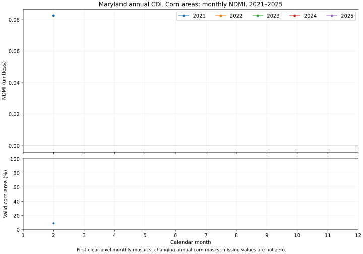

# 马里兰州玉米区域 2021–2025 逐月 NDMI：计算过程

本交付读取各年真实 USDA CDL 和 USGS Landsat 8/9 Collection 2 Level-2 地表反射率，目标为 2021–2025 共 60 个自然月。实际完成状态、观测覆盖率及异常以 `validation.json`、`run_summary_zh.md` 和结果 CSV 为准。NDMI 无单位；本产品不是土壤体积含水率，也不提供青贮/籽粒标签或经济结论。

## 1. 数据和统计范围

- 州界：Census TIGERweb，`STATE='24'`（Maryland）。州界快照位于 `data/processed/analysis/ndmi/inputs/maryland_boundary.geojson.gz`（gzip 解压后为 GeoJSON）。
- 玉米掩膜：USDA `CDL_WM/ImageServer` 按 `Year` 锁定唯一年度栅格，关闭渲染函数，读取单波段原始分类，只取 **class 1 (Corn)**。不含甜玉米、爆裂玉米或双季作物类别，不等同于 USDA 调查统计的播种/收获面积。
- 2021–2023 原始分类为 30 米；2024–2025 原始分类为 10 米。统一以最近邻读取到固定 EPSG:5070、30 米等面积网格。面积按选中网格像元数 × 900 平方米计算；边界采用像元中心位于州内，不作小数面积切割。10→30 米为中心取样，会产生分类面积误差。
- Landsat：Planetary Computer 提供的 USGS `landsat-c2-l2`，只取 Landsat 8/9、Tier 1，按州界外包矩形检索每个自然年。实际运算仍限制在州内对应年度玉米掩膜。全年度窗口为用户本次扩展，独立于 BARC 默认 4–11 月 NDVI 流程。
- `inputs/corn_YEAR.json` 记录年度产品对象 ID、精确导出 URL、各分类切片 SHA-256 和面积；`inputs/grid.json` 记录网格；`inputs/landsat_candidate_catalog.csv.gz`（gzip 压缩） 保存候选产品和未签名波段地址。

这是全州栅格作物掩膜分析，不把 BARC 的少量有标签田块当作全州样本。没有生成田块 ID，没有改变模型、前端及以前的面积预测。CDL 年度 Corn 类不区分本项目需要的最终 silage/grain 用途。

## 2. 像元计算

Landsat 8/9 的近红外使用 `SR_B5`（STAC `nir08`），短波红外使用 `SR_B6`（`swir16`）。先将数字量化值 DN 转成地表反射率：

```text
rho_B5 = DN_B5 × 0.0000275 − 0.2
rho_B6 = DN_B6 × 0.0000275 − 0.2
NDMI = (rho_B5 − rho_B6) / (rho_B5 + rho_B6)
```

**不能直接把 DN 代入归一化差值**：−0.2 的偏移不会在分母中抵消。两个反射率及 QA 均采用最近邻映射到同一网格，避免空间插值混入被剔除的像元。NDMI 存储精度为 float32，汇总均值使用 float64。

剔除条件：

| 检查 | 剔除规则 |
| --- | --- |
| 数据缺失 | B5 或 B6 的 DN 为 0 |
| QA_PIXEL | bits 0–5 任一为 1：fill、dilated cloud、cirrus、cloud、cloud shadow、snow |
| QA_RADSAT | bit 4（B5）、5（B6）或 11（terrain occlusion）为 1 |
| 数值质量 | 任一反射率为负、分母 ≤0、NDMI 非有限或超出 [-1,1] |

这是本分析的明确筛选规则；未另用 aerosol QA 过滤，不宣称所有大气污染均已清除。水体 bit 没有单独排除，统计范围由年度 Corn 掩膜控制。负反射率筛选会减少有效覆盖，不能把缺测当 0。

真实计算示例见 `data/processed/analysis/ndmi/pixel_calculation_examples.csv`：每行包含实际产品 ID、网格行列/坐标、DN、QA、反射率和 NDMI。数值测试使用的人工输入仅用于验证，不进入观测结果。

## 3. 每月如何汇总

采用确定性的 **逐像元首个有效观测拼接**：月内场景按 `(场景整体云量, 距当月15日的时间距离, 时间戳, 产品ID)` 升序。依次填充尚无有效值的玉米像元；同一个像元当月最多贡献一次。场景整体云量只用于排序，仍按像元 QA 去云。

```text
corn_area_ha = corn_pixel_count × 0.09
valid_area_ha = valid_pixel_count × 0.09
valid_area_fraction = valid_pixel_count / corn_pixel_count
ndmi_mean = sum(有效玉米像元的拼接 NDMI) / valid_pixel_count
```

等面积网格内，每个有效像元权重相同。另输出有效像元的中位数、p10 和 p90。**这是月度观测拼接的空间均值，不是所有过境观测的时间均值，也不是先平均反射率再求 NDMI。** 像元可能来自同月不同日期；使用场景、日期和贡献像元数在 `used_scenes.csv` 中可查。

全部场景均尝试完毕且至少一个有效值时状态 `computed`，不代表覆盖率 100%。读取错误导致的结果为 `partial_scene_errors` / `failed_scene_errors`；完全没有有效观测为 `no_valid_observations`。有效范围之外保留缺测，JSON 为 null，CSV 为空。

## 4. 输出合同

目录：`data/processed/analysis/ndmi/`。主表唯一键 `year+month`。

| 文件/字段 | 含义 |
| --- | --- |
| `maryland_corn_ndmi_monthly_2021_2025.csv` | 60 个目标月份的状态、NDMI、面积、覆盖率、场景数 |
| `corn_pixel_count`, `corn_area_ha` | 当年度玉米掩膜像元数及面积，作为月覆盖率分母 |
| `valid_pixel_count`, `valid_area_ha`, `valid_area_fraction` | 当月有有效 Landsat NDMI 的范围 |
| `ndmi_mean`, `ndmi_median`, `ndmi_p10`, `ndmi_p90` | 仅在有效玉米像元上计算的空间统计；无单位 |
| `candidate_scenes`, `used_scene_count`, `scene_error_count` | 检索、实际贡献及读取异常数量 |
| `months/YYYY_MM.json` | 每月详细规则、真实像元示例、使用场景及异常 |
| `used_scenes.csv` | 场景来源和每月实际贡献像元数；不含临时签名 |
| `pixel_calculation_examples.csv` | 实际 DN→反射率→NDMI 的可复核过程 |
| `inputs/` | 州界、网格、年度分类来源和候选场景清单 |

## 5. 运行命令

从仓库根目录执行，使用 Python 3.12。依赖只放 D 的子目录，不修改共享配置。

```sh
python3.12 -m venv /tmp/cornhub-ndmi-venv
/tmp/cornhub-ndmi-venv/bin/python -m pip install -r src/analysis/ndmi/requirements.txt
/tmp/cornhub-ndmi-venv/bin/python -m unittest discover -s src/analysis/ndmi -p 'test_*.py' -v
/tmp/cornhub-ndmi-venv/bin/python src/analysis/ndmi/calculate.py --workers 6
/tmp/cornhub-ndmi-venv/bin/python src/analysis/ndmi/export_results.py
```

可只运行一个月，例如 `--year 2023 --month 7 --workers 1`。`--prepare-only` 只获取年度分类掩膜和场景目录。默认缓存 `/tmp/cornhub_md_ndmi`；重新获取可指定一个新的 `--cache`。已存在的月度结果直接复用；需要重试某月时，先移走该月 JSON，避免误把旧部分结果当作重算。

读取采用公开数据接口，不需要个人 GEE/AWS 登录。公开只读 SAS 由容器级接口一次取得并在进程间共享，仅用于本次读取，不保存、不提交。限流遵循 Retry-After。先读取较小的 QA 波段；若待补像元全部被 QA 剔除，跳过反射率下载。至多两个活动窗口时直接按 COG 范围读取反射率，其余暂存完整反射率波段；读取网格和结果公式相同。原始栅格读完即删除，不进入 Git。每个完整场景之后保存数值数组和来源清单检查点，中断可从上一个检查点续算。中断留下的 `ndmi_scene_*` 临时目录在确认没有运行任务后可删除。6 个并发任务及掩膜通常需要数 GB 磁盘和内存；资源不足可使用 `--workers 1`。

`export_results.py` 默认要求完整 60 月且无场景错误；它检查面积、唯一键、月份匹配、场景贡献总数、分位数顺序及真实像元公式。`--allow-incomplete` 可明确输出 pending/partial 清单，不能因此声称完成全部月份。

## 6. 比较与解释限制

冬季指标描述“当年被分类为玉米的区域”当时的地表，不代表冬季存在活玉米。不同年份掩膜包含不同区域，不是同一批田块的配对实验。月度变化可能来自物候、裸地/收获、降雨及观测日期、残余大气污染、云雪可见范围和分类误差；本数据不独立识别因果。2024 年起源分辨率变化也会影响区域选择。

覆盖率低时，均值仅描述观测到的部分，缺测不一定随机。没有给出无观测像元的推断，也未验证 NDMI 与青贮/籽粒用途之间的预测能力。跨年月比较应同时查看覆盖率、日期和年度掩膜变化。原有 BARC 2024/2025 分类预测缺项不会被本次 NDMI 自动补齐。

官方依据及访问时间见本目录 `sources.csv`。真实执行结果见 `run_summary_zh.md` 和 `validation.json`。

可选绘图（完成导出后）：

```sh
/tmp/cornhub-ndmi-venv/bin/python -m pip install -r src/analysis/ndmi/plot_requirements.txt
MPLCONFIGDIR=/tmp/cornhub-mpl /tmp/cornhub-ndmi-venv/bin/python src/analysis/ndmi/plot_results.py
```



## NVIDIA/Brev 并行部署

[给管理员 AI 的完整执行提示词](nvidia_admin_prompt_zh.md) 包含连接、网络探针、依赖、GPU 对照、真实单月验收、持久后台批处理和交付要求。

新增可选 `--backend gpu --gpu-ids all`，使用 CuPy 计算同样的 DN 缩放、QA 与 NDMI；默认 CPU。多进程使用 spawn，每个进程按可见 GPU 轮转选卡，完成一个月份即可报告状态。`remote/launch.py` 根据实际 CPU 配额、可用 RAM/磁盘规划并发，不会自动采购实例。`remote/bootstrap.sh` 在持久目录创建独立环境。未安装 CuPy 或 GPU 初始化失败时，GPU 请求报错，不静默假装使用 GPU。

新增 `--retry-incomplete`：归档失败月份并从头重算；没有错误的场景检查点继续沿用。默认连续累计 3 个场景读取错误就停止该月，结果明确保留 partial/failed；`--max-scene-errors` 可调整。输出增加本次处理时间、检查点起始场景及 `compute_backend_this_attempt`。这些时间与后端字段仅描述本次尝试，不包含历史计算，也不代表全部历史检查点都在 GPU 上计算。

本地远程部署检查见 `remote/setup_status.json`。本机没有 NVIDIA CUDA，GPU 对照尚未实测；本地 CPU 合成性能测试仅是诊断，不是卫星观测结果，也不能证明云端或完整流程的加速倍数。
