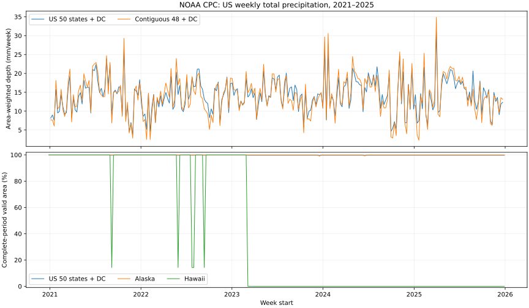

# 美国 2021–2025 年逐周降水数据总结

已实际下载 NOAA CPC 全球逐日降水文件，按周一至周日归并，并用 Census 2024 年简化州界与 0.5° 格点的相交面积加权。范围沿用此前 2021–2025 年。

**这是总降水水深，不能分离纯降雨；不是农田专用数据，也不是 NOAA 已发布的现成全国统计。以下是本仓库依据官方格点自行计算的结果。**

## 数据规模与范围

- 1,826 个源日期齐全；这不等于每个州每个格点都有效。
- 262 个周区间：260 个完整七天，首尾各一个三天区间标为 partial_week，不冒充完整周。
- 53 个统计范围：50 州＋华盛顿特区、US50_DC（50 州＋DC）、CONUS48_DC（本土 48 州＋DC）；13,886 行周数据。
- 不含波多黎各及其他美国海外领地；全美主表包含阿拉斯加、夏威夷的边界权重，但缺测区域不补零。
- 全美每周有效面积覆盖率 99.6412%–99.9602%。

## 必须注意的夏威夷缺测

**夏威夷有 148 个周区间没有任何格点能凑齐所需日期，结果为空；另有 5 周覆盖率低于 90%。不能声称 50 州每一周的数据均完整。** 这是输入缺值/连续七天要求造成的有效性缺口，不能解释为没有下雨；尚未独立核实这些源缺值的产生原因。

夏威夷 2021/2022 的全年连续有效区域仅约 14.28%，2023–2025 没有全年连续有效格点。对应年度结果不能当作完整全州气候；全国平均仍排除了缺测区，因此必须连同面积覆盖率使用。

补源核查：已找到 NASA/ORNL Daymet 作为潜在独立来源，但 2025 Hawaii 文件直接访问返回 HTTP 401，需要使用者自己的 Earthdata 授权。另测试的 NOAA PSL GPCP 年文件路径返回 404，未取得数据。没有用不同产品或插值偷偷补入 CPC。后续补源必须单列产品、单位、空间分辨率与时间口径。

## 年度汇总（mm）

年度值在全年每天都有效的格点上计算，因此与逐周变化覆盖范围下的周表相加未必相等。

| 年份 | 全美有效区域平均年累计 | 本土48州＋DC | 马里兰州 | 全美全年有效面积覆盖率 |
| --- | ---: | ---: | ---: | ---: |
| 2021 | 727.15 | 744.77 | 980.97 | 99.8077% |
| 2022 | 701.84 | 692.82 | 1078.23 | 99.8077% |
| 2023 | 739.04 | 732.41 | 978.97 | 99.6412% |
| 2024 | 780.36 | 792.23 | 947.17 | 99.6675% |
| 2025 | 743.81 | 739.05 | 959.55 | 99.7823% |

本口径下，五年中 2024 年最高（780.36 mm），2022 年最低（701.84 mm）；2025 比 2024 低 4.68%。这些是描述性比较，覆盖区有小幅变化，不能直接归因于气候趋势或单个灾害。

## 全美周累计最高的五个完整周

| 周一至周日 | 有效区域平均周累计 mm | 有效面积覆盖率 |
| --- | ---: | ---: |
| 2025-03-31–2025-04-06 | 30.99 | 99.7823% |
| 2024-01-22–2024-01-28 | 26.67 | 99.7823% |
| 2021-10-25–2021-10-31 | 26.52 | 99.9602% |
| 2024-01-08–2024-01-14 | 26.41 | 99.7823% |
| 2024-11-04–2024-11-10 | 24.56 | 99.7823% |

最高周描述的是全国有效区域平均水深，不能代表任意县、农场或田块。局地暴雨可能被全国平均稀释。

## 文件入口

- `weekly_us50_2021_2025.csv`：全美周表，可直接预览；含日期、mm、英寸、覆盖率及状态。
- `weekly_conus48_2021_2025.csv`：本土 48 州＋DC，避免误把 CONUS 叫全美。
- `weekly_all_scopes_2021_2025.csv.gz`：全部 53 个范围的完整 CSV，gzip 解压即可读取。
- `weekly_maryland_2021_2025.csv`、`weekly_ak_2021_2025.csv`、`weekly_hi_2021_2025.csv`：重点范围。
- `annual_summary_2021_2025.csv`、`coverage_below_90pct.csv`：年度汇总与需注意的覆盖缺口。
- `inputs/grid_state_weights.csv`：每州每格点的真实相交面积权重；`inputs/source_manifest.json`：原件 URL、SHA-256 和下载时间。
- 详细步骤、公式、运行命令及限制见 README.md；检查见 validation.json，真实逐日示例见 calculation_example.json。

